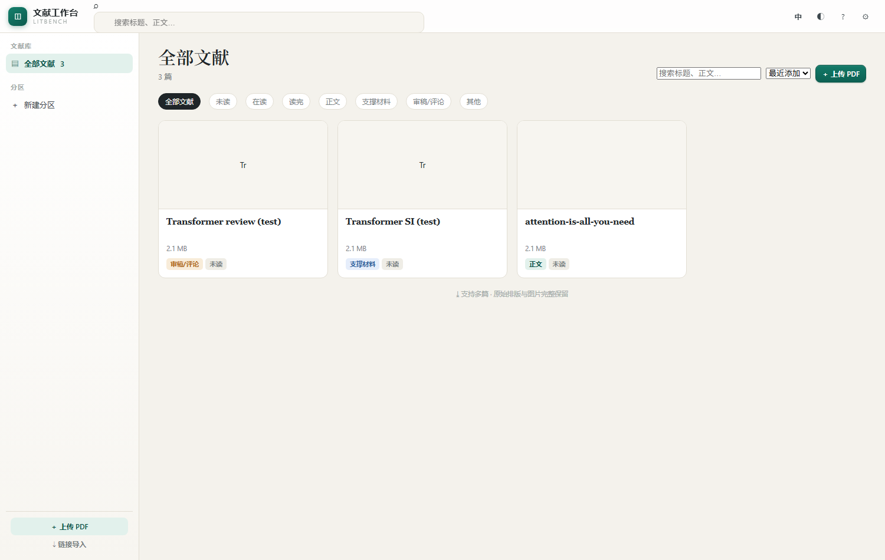
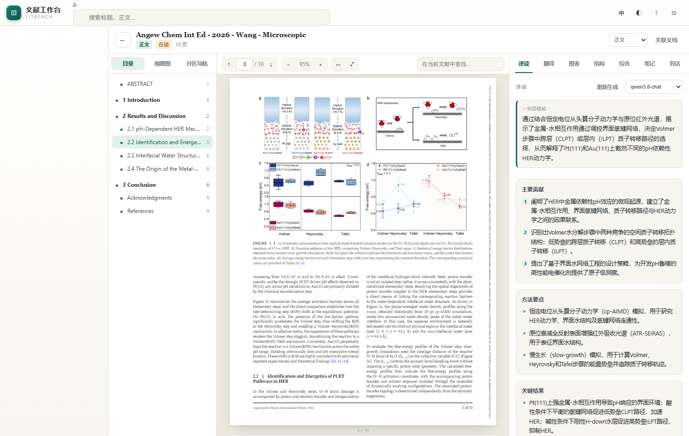

# LitBench

**本地优先的 PDF 文献阅读 + AI 分析工作台。**

零构建的原生前端（pdf.js canvas 渲染，排版/字体/公式/插图原样保留）+ 一个零依赖 Node 服务。
所有 AI 能力走你自己的 OpenAI 兼容端点，文献只存在你的机器上。

想先看全貌再决定要不要装？读 [**概览**](docs/OVERVIEW.md)：功能地图、设计取舍、三层阅读法的使用方式。



---

## 它能做什么

| 模块 | 能力 |
| --- | --- |
| **文献库** | 拖拽上传 / 链接导入（arXiv 等）、分区、标签、角色（正文 / SI 支撑材料 / 审稿意见 / 其他）、阅读状态与进度、全局全文搜索 |
| **阅读器** | 目录（自动抽取章节层级）、缩略图、分区导航；连续滚动、25%–400% 缩放、适宽/整页、页码跳转、页内查找（`n/总数` 步进） |
| **标注** | 选中文字弹出三按钮 —— **高亮**（5 色）/ **笔记** / **提问**；按页持久化，随时回看 |
| **速读** | 一句话概括、核心贡献、方法、结论、局限、关键词（关键词一键存为标签） |
| **翻译** | 逐段英译中，可「双语对照」或「仅译文」，40 段一批渐进加载，译文逐段落库 |
| **图表解读** | 按 caption 自动切出图区 → 视觉模型解读标题、要点、注意事项 |
| **论证结构树** | 论点 → 前提 / 证据 / 推理 / 结论 / 反例，分层折叠，带原文引文与页码 |
| **跨文档综合** | 把正文与关联的 SI / 审稿意见一起分析：摘要、互相印证、矛盾张力、SI 补充细节、审稿质疑 |
| **对话** | 针对全文或选中段落问答，SSE 流式输出，回答中的页码可点击跳转 |



---

## 快速开始

要求：Node.js ≥ 18（无需构建工具，无需数据库）。

```bash
git clone <repo-url> litbench
cd litbench
npm install          # 只装 pdfjs-dist（前端已经 vendor 一份，安装是可选的）
npm start            # 默认 http://127.0.0.1:8788
```

打开 <http://127.0.0.1:8788>，点右上角齿轮，填三样：

- **接口地址** —— 任意 OpenAI 兼容 `/v1` 端点
- **文本模型 / 视觉模型** —— 端点上的模型 id
- **API Key**

保存后即可上传第一篇 PDF。数据默认落在仓库下的 `data/`。

> **在 DeepSeek Harness 里跑**：如果本机存在 `~/.dsh`，工作台启动时会自动读取 DSH 当前使用的
> 模型供应商、接口地址、API Key 和模型列表（`profiles/*/cordis.patch.yml` + `.credentials.yaml`），
> 设置面板直接就是「DSH 现在能用的模型」，不必再手填一遍。检测不到才回落到通用默认值
> （`https://api.openai.com/v1` + `gpt-4o-mini`）。`/api/bootstrap` 的 `config.inheritedFrom`
> 为 `dsh` 即表示已继承，`modelsSource` 指向读到的配置文件。

### 环境变量

| 变量 | 作用 |
| --- | --- |
| `PORT` | 监听端口，默认 `8788` |
| `LITBENCH_DATA` | 数据目录（优先级最高） |
| `LITBENCH_BASE_URL` | 默认 API 端点（首次启动时用，之后以设置面板为准） |
| `LITBENCH_TEXT_MODEL` / `LITBENCH_VISION_MODEL` | 默认模型 id |
| `LITBENCH_API_KEY` | 默认 Key |
| `LITBENCH_KEY_FILE` | Key 文件路径，默认 `~/.litbench/key.txt` |
| `LITBENCH_MODELS` | 覆盖模型下拉列表，JSON：`[{"id":"gpt-4o","label":"GPT-4o","vision":true}]` |

服务默认只绑 `127.0.0.1`，不对外暴露。

---

## 存储位置

PDF、缩略图、抽好的正文文本、每篇的阅读状态都在同一个数据目录里，
可以在 **设置 → 文献存储目录** 里随时改到别的盘（比如杂乱的 C 盘换到数据盘），
并在切换时勾选「把现有文献一起搬到新目录」。

数据目录的解析顺序：

```
环境变量 LITBENCH_DATA  >  ~/.litbench/home.json 里的指针  >  仓库下 data/
```

---

## 模型建议

全篇 JSON 类任务（速读 / 结构树 / 综合）需要长输出能力，实测经验：

- 长 JSON 输出优先选 **关闭 reasoning 或支持结构化输出** 的对话模型；
- 带 reasoning 的模型容易把 token 预算吃在思维链上，正文返回空；
- 面板头部可以逐任务切换模型，选择会按文献记住。

图表解读需要 **vision** 能力的模型。

---

## 工作原理

```
server.js                    零依赖 HTTP 服务（127.0.0.1:8788）
  /api/bootstrap             配置 + 文献库
  /api/upload /api/import    PDF 入库
  /api/pdf/:id               octet-stream + Range（绕开下载拦截扩展）
  /api/papers/:id/state      GET/PUT 整篇状态（标注、速读、结构树、对话历史…）
  /api/storage               GET/POST 数据目录与迁移
  /api/search?q=             全库全文检索
  /api/chat                  OpenAI 兼容转发（SSE 流式）

public/
  js/core.js                 基础设施：i18n / api / store / markdown / toast / modal / streamChat
  js/app.js                  文献库、路由、搜索、上传、分区、设置
  js/reader.js               pdf.js 渲染 + 自建文本层 + 目录抽取 + 标注 + 查找
  js/insights.js             右栏 AI 面板（速读 / 翻译 / 图表 / 结构 / 综合）
  js/chat.js                 对话面板（关键词 RAG + SSE + 页码引用）
  vendor/                    pdfjs-dist（已 vendor，离线可用）
```

几点实现上的取舍：

- **不用官方 PDFViewer**：自己按页 canvas 渲染再叠一个文本层，坐标以 `scale=1` 存、渲染时乘缩放，选区与高亮才不会随缩放漂移。
- **目录与段落靠启发式抽取**：字号、加粗、章节编号、字母占比，加上「同 y 桶内 gap 断行 + 行级 Otsu 找双栏切点」，双栏论文不会把左右栏缝成一句。
- **每篇一个 state JSON**：前端 900ms 防抖保存，关闭阅读器时强制 flush，避免丢最后一次改动。

---

## 作为 DeepSeek Harness 插件（可选）

`plugin/` 是一个 DSH 插件包 `dsh-litbench`：随宿主启动、不额外占端口，
在会话头部加一个「文献工作台」按钮，点开是全屏 iframe。

```bash
npm run build:plugin     # 从 server.js 生成 plugin/server.cjs，并把 public/ 真实拷贝进 plugin/public/
```

安装：dsh plugin --profile desktop add dsh-litbench，
并在 profile 的 `package.json` 里加上 `dsh.profile.bundles` 条目。详见 `plugin/README.md`。

---

## 开发

```bash
npm run build:reader     # 把 public/js/_rA.js + _rB.js + _rC.js 拼成 reader.js
npm run test:storage     # 存储目录切换冒烟测试（需服务已启动）
```

`tools/` 下是开发期的端到端脚本：`cdp.mjs` 用无头 Chrome 打开页面、截图并执行一个 eval 文件，
`eval-*.js` 覆盖各面板。它们不是运行依赖。

## 已知问题

- pdf.js 偶发 `Math.sumPrecise is not a function`、`Cannot load system font: ...` 警告，无害。
- 目录抽取出错时：删掉该篇 state 里的 `sections/paragraphs/figures/extracted` 再打开会重抽。

## License

[MIT](LICENSE)
